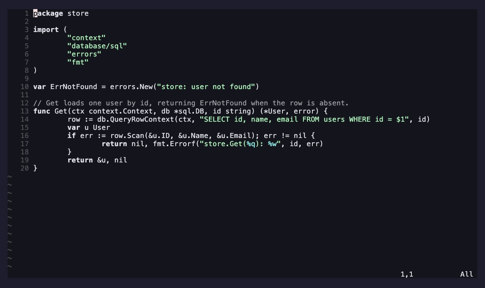

# ami-chat.nvim

The chat advisor panel for [ami](https://github.com/moosch/ami.nvim).

A floating transcript + prompt where you discuss your thinking and get streamed,
**advice-only** feedback grounded in your open file, selection, `README.md`/
`PLAN.md`, and — via LSP — the files your code depends on. It assembles each request
and streams it straight to LM Studio (no daemon).

It provides ami's `chat` capability (so other extensions can reach the panel) and a
`chat` model slot. The panel UI is swappable — install
[`ami-chat-split.nvim`](https://github.com/moosch/ami-chat-split.nvim) for a
split-window layout, or write your own `chat_ui` provider.

For multi-turn memory, branching, and `:AmiTree`, install
[`ami-history.nvim`](https://github.com/moosch/ami-history.nvim) (it provides the
`history` capability). Without it, chat keeps an in-memory history for the current
session only.

## Demo

Discuss a problem, get advice-only feedback in the right-docked, see-through panel:



> Rendered from [`demos/chat.tape`](demos/chat.tape); see
> [`demos/README.md`](demos/README.md) to (re)generate it.

## Requirements

- [ami.nvim](https://github.com/moosch/ami.nvim) (the runtime: daemon, model
  registry, extension API).

## Install

With [lazy.nvim](https://github.com/folke/lazy.nvim), install it alongside ami and
register it:

```lua
{
  "moosch/ami.nvim",
  dependencies = { "moosch/ami-chat.nvim" },
  build = "make build",
  config = function()
    require("ami").setup({
      extensions = { require("ami-chat") },
      -- chat = { ui = { position = "right", opacity = 0.8 } },  -- optional
    })
  end,
}
```

## Commands

| Command | What it does |
| --- | --- |
| `:AmiChat` | Toggle the panel (`<CR>` normal-mode = send, `<C-n>` new session, `q`/`<Esc>` hide) |
| `:AmiAsk {text}` | One-shot question; visual mode sends the selection + its deps |
| `:AmiNewSession [name]` | Start a fresh conversation |
| `:AmiStop` | Stop the in-flight reply (also `<C-c>` in the panel) |

Pick the chat model live with `:AmiModel chat`. A reply also stops if you close the
panel, and gives up on its own if no token arrives within `timeout_ms`.

## Configuration

Options live under `chat` in ami's `setup()`:

| Key | Default | Meaning |
| --- | --- | --- |
| `endpoint` | `nil` | provider base URL; `nil` ⇒ ami's default `model.endpoint` |
| `model` | `nil` | chat model; `nil` ⇒ ami's default `model.model` (pick via `:AmiModel chat`) |
| `timeout_ms` | `120000` | give up if no token arrives within this long (covers cold model loads) |
| `ui.position` | `"right"` | `"right"` \| `"left"` \| `"center"` |
| `ui.width` / `ui.height` | `0.4` / `0.9` | fraction of screen (`<=1`) or absolute cells (`>1`) |
| `ui.opacity` | `0.8` | `0`..`1`; lower = more see-through (via `winblend`) |
| `ui.margin` | `2` | columns of gap from the screen edge |
| `keymaps.send` | `"<CR>"` | send the prompt (normal mode) |
| `keymaps.send_alt` | `"<C-s>"` | send (normal + insert; some terminals eat `<C-s>`) |
| `keymaps.new_session` | `"<C-n>"` | start a new session (normal + insert) |
| `keymaps.stop` | `"<C-c>"` | stop the in-flight reply (normal + insert) |
| `keymaps.close` | `{ "q", "<Esc>" }` | hide the panel (normal mode) |
| `keymaps.toggle` | `nil` | optional global normal-mode map for `:AmiChat` (e.g. `"<leader>ac"`) |

Each `keymaps.*` value is a string, a list of strings, or `false` to disable that
binding. `ui.*`/`keymaps.*` apply to the built-in floating panel; when a `chat_ui`
provider like `ami-chat-split.nvim` is active, that extension's own options apply.
You can also always `vim.keymap.set` the `:AmiChat`/`:AmiAsk`/`:AmiNewSession`
commands yourself.

## Syntax highlighting

The transcript is a markdown buffer highlighted like telescope's previewer — it uses
**whatever's available in your Neovim**:

- **Treesitter** (preferred): started automatically when the `markdown` parser is
  installed. This highlights headers, inline code, and — via markdown injections —
  fenced code blocks **in their own language**. Per-language code highlighting needs
  that language's parser too, e.g. `:TSInstall go lua` (install `markdown` and
  `markdown_inline` for the base).
- **Regex syntax** (fallback): if no treesitter parser is available, it falls back to
  the built-in markdown syntax (headers + inline code; fenced blocks per
  `vim.g.markdown_fenced_languages`).

Either way it's automatic and has no hard dependency — with nothing installed you
still get plain, readable text.

## Replacing the panel UI

The chat controller draws nothing itself — it drives whatever `chat_ui` provider is
registered, falling back to the bundled floating panel (`lua/ami-chat/ui.lua`). See
ami's [`docs/extensions.md`](https://github.com/moosch/ami.nvim/blob/main/docs/extensions.md)
for the `chat_ui` contract.

## License

[MIT](LICENSE)
